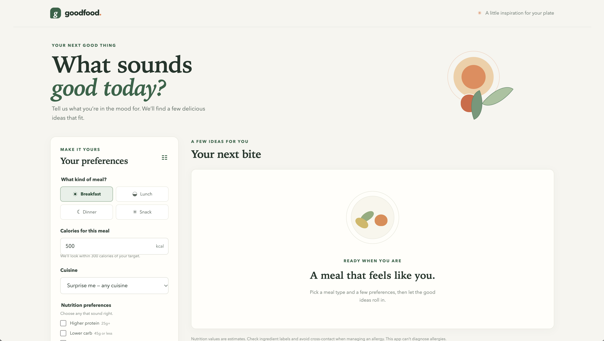

# Project Log

## Entry Information

- **Date:**
- **Project:**
- **Contributor:**
- **Time spent:**

## Objectives

### Planned for this entry

- [ ] 
- [ ] 
- [ ] 

### Completed

- [x] 
- [ ] 

## Summary

Briefly describe the work completed and the current state of the project.

## Work Details

| Task | Result | Status | Next action |
|---|---|---|---|
|  |  |  |  |
|  |  |  |  |

## Decisions and Changes

- **Decision:**
  - **Reason:**
  - **Impact:**

## Problems and Risks

| Issue or risk | Severity | Mitigation | Owner |
|---|---|---|---|
|  |  |  |  |

## Resources and References

- Files:
- Links:
- Documentation:

## Testing and Validation

- **Tests performed:**
- **Results:**
- **Issues found:**

## Next Steps

- [ ] 
- [ ] 
- [ ] 

## Notes

---

## What Claude Built:
Claude built the styles.css, index.html, and app.js pages

## Two Things I Learned:
- I learned how to connect github to my account
- I learned how to use AI in planning mode

## What I Changed Myself:
- I changed the range that decided whether a food was considered high protein

# AI Assistance Chat Record

## Session Summary

This chat was used to prepare and publish the web application in this project.

The assistant:

1. Inspected the project directory and confirmed that it contained a static web app.
2. Initialized a Git repository with `main` as the default branch.
3. Staged all web-app files and reviewed the staged file list.
4. Created the initial commit, `00b4695 Initial commit`.
5. Added `https://github.com/trbullock/cs191.git` as the `origin` remote.
6. Pushed the `main` branch to GitHub and configured it to track `origin/main`.
7. Confirmed that the working tree was clean and the remote was configured.
8. Explained the GitHub Pages settings needed to deploy the app from the `main` branch and `/ (root)` folder.
9. Created this reusable project-log template when requested.

## Chat Requests and Responses

### Repository setup

**User request:** Create a Git repository, use `main` as the branch name, make an initial commit containing all files, and push it to a newly created GitHub repository.

**Assistant response:** The assistant inspected the folder, initialized Git, staged and reviewed the files, created the initial commit, added the GitHub remote, pushed `main`, and verified the final repository state.

**Result:** The project was committed and published at <https://github.com/trbullock/cs191>.

### GitHub Pages

**User request:** Explain how to launch the app with GitHub Pages.

**Assistant response:** The assistant explained that Pages should use **Deploy from a branch**, select `main`, and use `/ (root)`, then visit:

<https://trbullock.github.io/cs191/>

### Project log

**User request:** Generate a document template for the project log.

**Assistant response:** The assistant created `Project-Log-Template.md` with sections for entry information, objectives, completed work, decisions, risks, resources, testing, next steps, and notes.

**User follow-up:** Append this chat and a summary of the assistant's responses.

**Assistant response:** The assistant appended this session record and summary to the project log template.

## Attached Image

